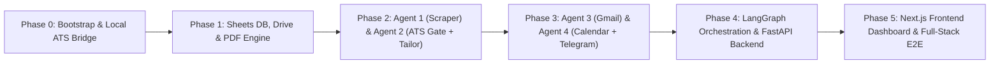

# Phased Implementation Plan (`plan.md`)

> **Project:** Autonomous 4-Agent Job Application & Interview Coordinator (Full-Stack: Backend + Next.js Frontend)  
> **Strategy:** Phased Batch Execution with Local ATS Checker Bridge, FastAPI Backend, Next.js Web Dashboard & Spec-Driven Verification

---

## 1. Proposed Full-Stack Repository Structure

```text
job-agent/
├── prd.md                          # Original Product Requirements Document
├── spec/                           # Spec-Driven Development (SDD) Artifacts
│   ├── README.md                   # SDD Workflow Guide & Document Index
│   ├── constitution.md             # Project Guardrails & Non-Negotiable Rules
│   ├── spec.md                     # Full-Stack Technical & Behavioral Specification
│   ├── plan.md                     # Phased Implementation & Architecture Plan
│   ├── tasks.md                    # Actionable Phased Task Checklist
│   └── checklist.md                # Phase Quality Gates & Verification Criteria
├── .env.example                    # Template for API keys, OAuth paths, & Local ATS config
├── pyproject.toml                  # Backend dependencies & metadata (uv / pip)
├── data/
│   ├── master_resume.md            # User's canonical Master Resume in Markdown
│   └── master_resume.json          # Optional structured representation for ATS checker
├── output/
│   └── resumes/                    # Locally rendered tailored PDFs before Drive upload
├── credentials/                    # Git-ignored folder for Google OAuth / Service Account JSONs
├── src/
│   └── job_agent/
│       ├── __init__.py
│       ├── config.py               # Pydantic Settings loading .env variables
│       ├── models/
│       │   ├── __init__.py
│       │   ├── schemas.py          # ExtractedJobListing, MatchEvaluation, EmailClassification
│       │   └── state.py            # LangGraph TypedDict / Pydantic State definitions
│       ├── integrations/
│       │   ├── __init__.py
│       │   ├── ats_adapter.py      # Bridge to Existing Local ATS Checker (Import / HTTP / CLI)
│       │   ├── sheets_client.py    # Google Sheets (gspread) state store & idempotent upsert
│       │   ├── drive_client.py     # Google Drive PDF uploader & share link generator
│       │   ├── pdf_renderer.py     # Markdown -> ATS-clean PDF converter
│       │   ├── jsearch_client.py   # JSearch RapidAPI client + pluggable JobSourceProvider
│       │   ├── gmail_client.py     # Gmail API thread reader & reply sender
│       │   ├── calendar_client.py  # Google Calendar free/busy finder & event creator
│       │   └── telegram_bot.py     # Telegram inline keyboard notifications & callback handler
│       ├── agents/
│       │   ├── __init__.py
│       │   ├── agent1_sourcing.py  # Agent 1: Scraper & Pre-Filtering (gemini-2.5-flash)
│       │   ├── agent2_tailor.py    # Agent 2: Local ATS Gatekeeper (>=50%) & Pro Tailor
│       │   ├── agent3_inbox.py     # Agent 3: Gmail Monitor & Classifier (gemini-2.5-flash)
│       │   └── agent4_calendar.py  # Agent 4: Calendar Slot Finder & Web/Telegram Coordinator
│       ├── workflows/
│       │   ├── __init__.py
│       │   ├── sourcing_graph.py   # LangGraph Workflow A (Agent 1 -> Agent 2)
│       │   └── inbox_graph.py      # LangGraph Workflow B (Agent 3 <-> Agent 4)
│       ├── api/                    # FastAPI Backend Server for Next.js Frontend
│       │   ├── __init__.py
│       │   ├── server.py           # FastAPI app, CORS, SSE event bus
│       │   └── routes/
│       │       ├── dashboard.py    # GET /api/dashboard/stats, /api/health
│       │       ├── jobs.py         # GET /api/jobs, PATCH /api/jobs/{job_id}/status
│       │       ├── ats_studio.py   # POST /api/ats/evaluate, /api/resumes/{job_id}/tailor
│       │       ├── inbox.py        # POST /api/workflows/inbox-sync, GET /api/inbox/threads
│       │       └── interviews.py   # GET /api/interviews/{job_id}/slots, POST /confirm
│       └── main.py                 # Unified CLI & FastAPI server launcher
├── frontend/                       # Next.js 15 + TypeScript + Tailwind CSS + shadcn/ui
│   ├── package.json
│   ├── next.config.ts
│   ├── tailwind.config.ts
│   └── src/
│       ├── app/
│       │   ├── layout.tsx          # App Shell with Sidebar Navigation & Live Agent Status Bar
│       │   ├── page.tsx            # View 1: Command Center & Pipeline KPI Dashboard
│       │   ├── jobs/
│       │   │   └── page.tsx        # View 2: Job Tracker Table, Kanban & ATS Gate Drawer
│       │   ├── studio/
│       │   │   └── page.tsx        # View 3: Resume Tailor Studio & Local ATS Sandbox
│       │   ├── interviews/
│       │   │   └── page.tsx        # View 4: Inbox Classifier Feed & Calendar HITL Scheduler
│       │   └── settings/
│       │       └── page.tsx        # View 5: Integrations Health & Master Resume Editor
│       ├── components/
│       │   ├── dashboard/          # KPI cards, Sourcing run modal, Live SSE console
│       │   ├── jobs/               # Job table, Match Score badge (<50% vs >=50%), Gap drawer
│       │   ├── studio/             # Local ATS score gauge, Side-by-side Markdown/PDF viewer
│       │   └── interviews/         # Slot selector cards (Option A/B/C), Email approval modal
│       └── lib/
│           ├── api.ts              # Typed API client talking to FastAPI backend
│           └── types.ts            # TypeScript interfaces mirroring Pydantic schemas
└── tests/                          # Backend & API Pytest Suite
```

---

## 2. How We Integrate Your Existing Local ATS Checker

Since you have already built the local ATS resume checker, **we do not rebuild ATS scoring logic**. Instead, `src/job_agent/integrations/ats_adapter.py` implements an **Adapter Pattern** (`ATSCheckerAdapter`) used by both **Agent 2** and the **Frontend ATS Studio (`/studio`)**:

1. **Option A — Direct Python Import Mode (`ATS_INTEGRATION_MODE=python_import`):**
   * Imports your local ATS checker package/module from `ATS_LOCAL_REPO_PATH` and calls it directly in-process.
2. **Option B — Local HTTP Server Mode (`ATS_INTEGRATION_MODE=http_local`):**
   * Sends a `POST` request to your local ATS server (e.g., `http://127.0.0.1:8000/evaluate`).
3. **Option C — Local CLI / Subprocess Mode (`ATS_INTEGRATION_MODE=cli_subprocess`):**
   * Runs your local ATS CLI command and parses JSON output into `MatchEvaluation`.

---

## 3. Phased Implementation Batches (Full-Stack)

We organize the build into **6 sequential phases (Phase 0 – Phase 5)** so backend agents, API endpoints, and frontend views are verified cleanly in batches:



### Phase 0: Project Bootstrap & Local ATS Checker Bridge
* Initialize Python environment (`pyproject.toml`), `.env.example`, `config.py`, Pydantic schemas (`schemas.py`), and connect your **existing local ATS checker** via `ATSCheckerAdapter` (`ats_adapter.py`).

### Phase 1: Data & Storage Layer (Google Sheets, Google Drive & PDF Renderer)
* Build `sheets_client.py` (`gspread` 11-column schema + idempotent `Job ID` upsert), `data/master_resume.md`, `pdf_renderer.py` (Markdown $\rightarrow$ ATS-clean PDF), and `drive_client.py` (Google Drive PDF upload & share link).

### Phase 2: Sourcing & ATS Gatekeeper Pipeline (Agent 1 & Agent 2)
* Implement Agent 1 (JSearch API + `gemini-2.5-flash` structured extraction) and Agent 2 (Local ATS Checker $\ge 50\%$ gatekeeper + `gemini-2.5-pro` STAR-method tailoring + PDF/Drive pipeline).

### Phase 3: Inbox Monitor & Human-in-the-Loop Coordinator (Agent 3 & Agent 4)
* Implement Agent 3 (Gmail API thread polling + `gemini-2.5-flash` classification) and Agent 4 (Google Calendar free-slot lookup + Telegram Bot inline button notification + calendar booking + approved email reply trigger).

### Phase 4: LangGraph Orchestration & FastAPI Backend Server
* Wire Agents 1–4 into LangGraph workflows (`sourcing_graph.py` and `inbox_graph.py`).
* Build the **FastAPI Backend (`src/job_agent/api/`)** exposing REST + SSE endpoints (`/api/dashboard/stats`, `/api/jobs`, `/api/workflows/source`, `/api/ats/evaluate`, `/api/resumes/{job_id}/preview`, `/api/inbox/threads`, `/api/interviews/{job_id}/confirm`).

### Phase 5: Next.js Frontend Web Application & End-to-End Integration
* Scaffold `frontend/` with **Next.js 15 (App Router, TypeScript), Tailwind CSS, and shadcn/ui**.
* Build all 5 views:
  1. **Command Center (`/`)**: KPI cards, Run Sourcing modal, and live SSE Agent execution stream.
  2. **Job Tracker & ATS Gate Explorer (`/jobs`)**: Filterable table + Kanban board synced with Google Sheets, `<50%` vs `>=50%` score badges, and Gap Analysis drawer.
  3. **Resume Tailor Studio & Local ATS Sandbox (`/studio`)**: Interactive tester for your Local ATS Checker + side-by-side Master vs. Tailored Resume Markdown/PDF viewer.
  4. **Inbox & Interview Coordinator Hub (`/interviews`)**: Classified Gmail threads, interactive Google Calendar slot picker (`Option A/B/C`), and Email Reply Approval modal.
  5. **Settings & Integrations Health (`/settings`)**: Live status checks for Local ATS Checker, Google Workspace, JSearch, and Telegram Bot + Master Resume editor.
