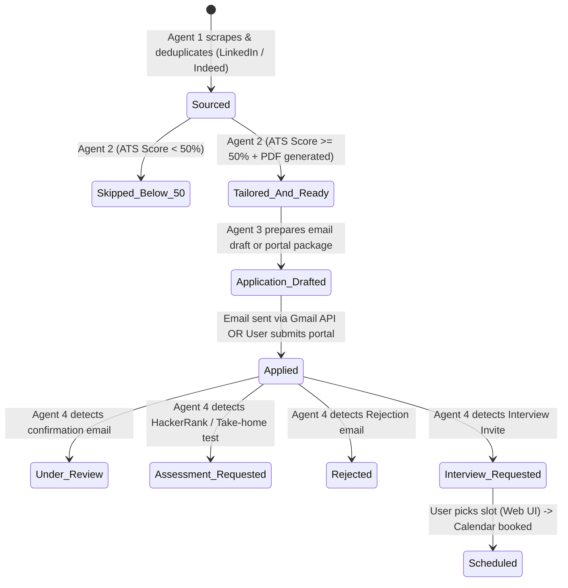

# Technical & Behavioral Specification (`spec.md`)

> **Project:** Autonomous 4-Agent Job Application & Interview Coordinator (Full-Stack)  
> **Version:** 2.0.0 (Zero Seed Data, Real Google OAuth2, Application Dispatch & Truthful Lifecycle)  
> **Source PRD:** [`prd.md`](../prd.md)  
> **Architecture:** Next.js 15 Web Dashboard $\leftrightarrow$ FastAPI Server $\leftrightarrow$ LangGraph Multi-Agent Pipeline + Local ATS Checker (`ATS-Checker`) + Google Workspace (Gmail, Sheets, Drive, Calendar)

---

## 1. Full-Stack System Architecture & Data Flow

```
┌────────────────────────────────────────────────────────────────────────────────────────┐
│                        Next.js 15 Frontend Web Application                             │
│  ┌──────────────┐ ┌──────────────┐ ┌──────────────────┐ ┌───────────────────────────┐  │
│  │ Pipeline KPI │ │ Job Tracker  │ │ Resume Studio &  │ │ Application Dispatch &    │  │
│  │  Dashboard   │ │ Table/Kanban │ │ ATS-Checker Test │ │ Inbox / Calendar Center   │  │
│  └──────┬───────┘ └──────┬───────┘ └────────┬─────────┘ └─────────────┬─────────────┘  │
└─────────┼────────────────┼──────────────────┼─────────────────────────┼────────────────┘
          │                │  REST API + SSE  │                         │
          ▼                ▼                  ▼                         ▼
┌────────────────────────────────────────────────────────────────────────────────────────┐
│                    FastAPI Backend Server (`src/job_agent/api`)                        │
│  ┌─────────────────────────┐  ┌─────────────────────────┐  ┌────────────────────────┐  │
│  │ Google OAuth2 Auth Flow │  │ Application Dispatcher  │  │ Local ATS Bridge Client│  │
│  └─────────────────────────┘  └─────────────────────────┘  └────────────────────────┘  │
└─────────────────────────────────────────┬──────────────────────────────────────────────┘
                                          │
                                          ▼
┌────────────────────────────────────────────────────────────────────────────────────────┐
│                             LangGraph Orchestrator                                     │
│      (StateGraphs: Sourcing & ATS Gate -> Application Dispatch -> Inbox & Calendar)     │
└──────────┬───────────────────────┬─────────────────────────┬────────────────────────┬──┘
           │                       │                         │                        │
           ▼                       ▼                         ▼                        ▼
┌──────────────────┐    ┌─────────────────────┐    ┌──────────────────┐    ┌──────────────────┐
│     Agent 1:     │    │      Agent 2:       │    │     Agent 3:     │    │     Agent 4:     │
│   Sourcing &     │───►│ Local ATS-Checker & │───►│   Application    │───►│  Inbox Monitor & │
│  Pre-Filtering   │    │ STAR Resume Tailor  │    │  Dispatcher &    │    │ Calendar HITL    │
│(LinkedIn/Indeed) │    │   (>=50% Cutoff)    │    │  Submission Hub  │    │  Coordinator     │
└──────────┬───────┘    └──────────┬──────────┘    └─────────┬────────┘    └─────────┬────────┘
           │                       │                         │                       │
           ▼                       ▼                         ▼                       ▼
┌────────────────────────────────────────────────────────────────────────────────────────┐
│           Google Workspace (Live OAuth2: Gmail, Sheets, Drive, Calendar)               │
│                  (Zero Fake Seed Data: Truthful State Only)                            │
└────────────────────────────────────────────────────────────────────────────────────────┘
```

---

## 2. Canonical Data Schemas (`Pydantic` Models)

### 2.1 Candidate Profile Schema
```python
from pydantic import BaseModel, Field, EmailStr

class CandidateProfile(BaseModel):
    full_name: str = Field(description="Full legal name of the candidate")
    email: str = Field(description="Candidate contact email")
    phone: str = Field(default="", description="Candidate phone number")
    linkedin_url: str = Field(description="Public LinkedIn profile URL")
    github_url: str = Field(default="", description="GitHub profile URL")
    portfolio_url: str = Field(default="", description="Personal portfolio or website URL")
    location: str = Field(default="Remote", description="Candidate primary location / timezone")
```

### 2.2 Sourced Job Listing Schema (Agent 1 Output)
```python
from typing import Literal, Optional
from pydantic import BaseModel, Field

class ExtractedJobListing(BaseModel):
    job_id: str = Field(description="Deterministic 12-char MD5 hash of normalized company + role")
    company_name: str
    role_title: str
    location: str = "Remote"
    is_remote: bool = True
    sponsorship_explicitly_mentioned: bool = False
    source_platform: Literal["LinkedIn", "Indeed", "Glassdoor", "ZipRecruiter", "Direct Career Site"] = "LinkedIn"
    job_url: str = Field(description="Direct posting application or portal link")
    raw_description: str
    application_method: Literal["email_submission", "portal_submission"] = "portal_submission"
    application_email: Optional[str] = Field(default=None, description="Direct email if job requires applying via email")
```

### 2.3 ATS Match Evaluation Schema (Agent 2 Gatekeeper)
```python
class MatchEvaluation(BaseModel):
    match_score: int = Field(ge=0, le=100, description="Percentage match 0 to 100")
    missing_critical_skills: list[str] = Field(default_factory=list)
    matched_skills: list[str] = Field(default_factory=list)
    passed_threshold: bool = Field(description="True ONLY if match_score >= 50, otherwise False")
    reasoning: str = Field(description="Detailed gap analysis")
    ats_source: str = Field(default="ATS-Checker", description="Engine that evaluated the score")
```

### 2.4 Application Dispatch Schema (Agent 3 Output)
```python
class ApplicationDispatch(BaseModel):
    job_id: str
    company_name: str
    role_title: str
    submission_method: Literal["email_submission", "portal_submission"]
    recipient_email: Optional[str] = None
    portal_url: Optional[str] = None
    cover_subject: str = ""
    cover_body: str = ""
    tailored_pdf_path: str = ""
    tailored_drive_link: str = ""
    candidate_linkedin: str = ""
    candidate_portfolio: str = ""
    screening_qa: dict[str, str] = Field(
        default_factory=dict,
        description="Pre-generated STAR answers for common application form questions"
    )
    status: Literal["Draft Prepared", "Dispatched (Sent)", "Portal Ready"] = "Draft Prepared"
    dispatched_at: Optional[str] = None
```

### 2.5 Recruiter Email Classification Schema (Agent 4 Input)
```python
class EmailClassification(BaseModel):
    thread_id: str
    company_name: str
    role_title: str = ""
    job_id: Optional[str] = None
    category: Literal["Interview Invite", "Rejection", "Assessment Request", "Application Received", "Neutral"]
    summary: str
    scheduling_url: Optional[str] = Field(default=None, description="Direct Calendly, Greenhouse, Ashby or Lever link if present")
    proposed_times_raw: list[str] = Field(default_factory=list)
    sender_email: str
    subject: str
    received_at: str
```

---

## 3. Truthful Application Lifecycle State Machine

No application may jump to `Interview Requested` without actually having been dispatched and applied to.



---

## 4. Google Sheets Relational Schema (13 Columns)

| Col # | Column Name | Modifying Agent / UI | Type / Format | Description |
| :--- | :--- | :--- | :--- | :--- |
| **A** | `Job ID` | Agent 1 | String (12-char MD5) | Deterministic unique key |
| **B** | `Company Name` | Agent 1 | String | Hiring company |
| **C** | `Role Title` | Agent 1 | String | Target role |
| **D** | `Source Platform` | Agent 1 | String | LinkedIn, Indeed, Glassdoor, etc. |
| **E** | `Initial Match Score` | Agent 2 | Percentage String | ATS match score (0–100%) |
| **F** | `Passed Gate (>=50%)` | Agent 2 | Boolean (`TRUE`/`FALSE`)| Gate threshold evaluation |
| **G** | `Gap Analysis` | Agent 2 | String | Missing skills & reason |
| **H** | `Status` | Agent 2 / 3 / 4 / UI | Enum String | `Skipped` \| `Tailored & Ready` \| `Application Drafted` \| `Applied` \| `Assessment Requested` \| `Rejected` \| `Interview Requested` \| `Scheduled` |
| **I** | `Submission Method` | Agent 3 | String | `Email Submission` or `Portal Submission` |
| **J** | `Date Applied` | Agent 3 / UI | ISO Date String | Timestamp when application was actually submitted |
| **K** | `Tailored Resume Link` | Agent 2 | URL String | Google Drive / local PDF link |
| **L** | `Interview Date` | Agent 4 / UI | ISO Timestamp String | Confirmed interview date/time |
| **M** | `Job URL` | Agent 1 | URL String | Direct application link |

---

## 5. Agent Behavioral Specifications

### 5.1 Agent 1: Sourcing & Pre-Filtering Engine
* **Platform Ingestion:** Fetches postings tagged by source: `LinkedIn`, `Indeed`, `Glassdoor`, `Direct Portal`.
* **Application Method Detection:**
  * Detects if the listing instructs candidates to email directly (`jobs@...`, `careers@...`) or apply through an ATS portal (Greenhouse, Lever, Workday, Ashby, LinkedIn Easy Apply).
* **Extraction:** Uses `gemini-2.5-flash` with `response_schema=ExtractedJobListing` (`temperature=0.1`).
* **Deduplication:** Filters out existing `Job ID` hashes from Google Sheets.

### 5.2 Agent 2: Local ATS Gatekeeper & STAR Tailor
* **Connection to Local ATS:** Communicates directly with `/Users/beebee/Desktop/personal project/ATS-Checker` via `ATSCheckerAdapter`.
* **$\ge 50\%$ Gatekeeper:**
  * Score $< 50\% \rightarrow$ Marks `Skipped (<50% Match)` and populates `Gap Analysis`. Halts tailoring.
  * Score $\ge 50\% \rightarrow$ Invokes `gemini-2.5-pro` (`temperature=0.3`) to rewrite bullet points using the STAR method without fabricating experience. Renders ATS-compliant PDF.

### 5.3 Agent 3: Application Dispatcher & Submission Engine
* **Direct Email Applications:**
  * Generates a tailored cover email highlighting candidate's matched skills.
  * Injects candidate's real LinkedIn URL, portfolio, and contact details.
  * Attaches the tailored resume PDF.
  * Creates a live **Gmail Draft** (or sends directly upon user 1-click approval).
  * Transitions status to **`Applied`** with current timestamp.
* **Portal / Form Applications (LinkedIn, Greenhouse, Lever, etc.):**
  * Packages the application bundle: direct portal link, one-click PDF download, and AI-generated answers for standard screening questions (e.g. salary expectation, sponsorship, notice period, STAR experience summaries).
  * User submits in 1 click and marks **`Applied`**.

### 5.4 Agent 4: Inbox Monitor & Calendar HITL Coordinator
* **Inbox Monitoring:** Queries Gmail API *only for companies that have reached `Applied` status*.
* **Scheduling Link Detection:** If recruiter email contains a scheduling link (Calendly, Ashby, Greenhouse, Lever), Agent 4 extracts the link and displays your conflict-free calendar slots side-by-side in the Web UI.
* **Reply Availability:** If recruiter asks for availability, Agent 4 checks Google Calendar `freebusy`, drafts a response with open slots, and allows 1-click approval.
* **Interview Booking:** On confirmation, books Google Calendar event and updates Google Sheets `Interview Date` + `Status = "Scheduled"`.

---

## 6. Real Google Workspace OAuth2 Integration

The backend provides a standardized Google OAuth2 flow storing credentials securely in `credentials/token.json`:

| Endpoint | Method | Description |
| :--- | :--- | :--- |
| `/api/auth/google/url` | `GET` | Returns Google OAuth2 authorization URL requesting scopes for Gmail (`modify`, `compose`), Google Sheets, Drive, and Calendar. |
| `/api/auth/google/callback` | `POST` | Receives authorization code, exchanges for refresh token, and saves `credentials/token.json`. |
| `/api/auth/google/status` | `GET` | Returns authenticated user email, token validity, and connected scopes. |
| `/api/auth/google/disconnect` | `POST` | Revokes and deletes local tokens. |

---

## 7. Next.js Web Dashboard View Specifications

1. **Command Center (`/`):**
   * Real stats (strictly 0 when no jobs applied).
   * Google Account connection banner (shows user email when connected, or "Connect Google Account" button).
   * Real-time Sourcing & Dispatch trigger buttons with live SSE log stream.
2. **Job Tracker (`/jobs`):**
   * Table & Kanban views showing truthful status transitions: `Skipped` $\rightarrow$ `Tailored` $\rightarrow$ `Application Drafted` $\rightarrow$ `Applied` $\rightarrow$ `Interview Requested` $\rightarrow$ `Scheduled`.
   * Column filter by Source Platform (`LinkedIn`, `Indeed`, `Direct`).
3. **Application Dispatch Hub (`/dispatch`):**
   * Review pending email drafts before sending.
   * View portal links + pre-filled screening question answers for form submissions.
   * One-click "Send Application Email" and "Mark Applied".
4. **ATS Sandbox & Resume Studio (`/studio`):**
   * Interactive tester connected directly to `/Users/beebee/Desktop/personal project/ATS-Checker`.
   * Side-by-side Master Resume vs. Tailored Resume & PDF viewer.
5. **Inbox & Interview Coordinator (`/interviews`):**
   * Filtered inbox feed of real recruiter responses.
   * Side-by-side recruiter booking link + conflict-free calendar slots.
6. **Settings & Candidate Profile (`/settings`):**
   * Edit Candidate Profile (`FULL_NAME`, `LINKEDIN_URL`, `PORTFOLIO_URL`, etc.).
   * One-click Google OAuth2 connection status & Local ATS Checker health check.
